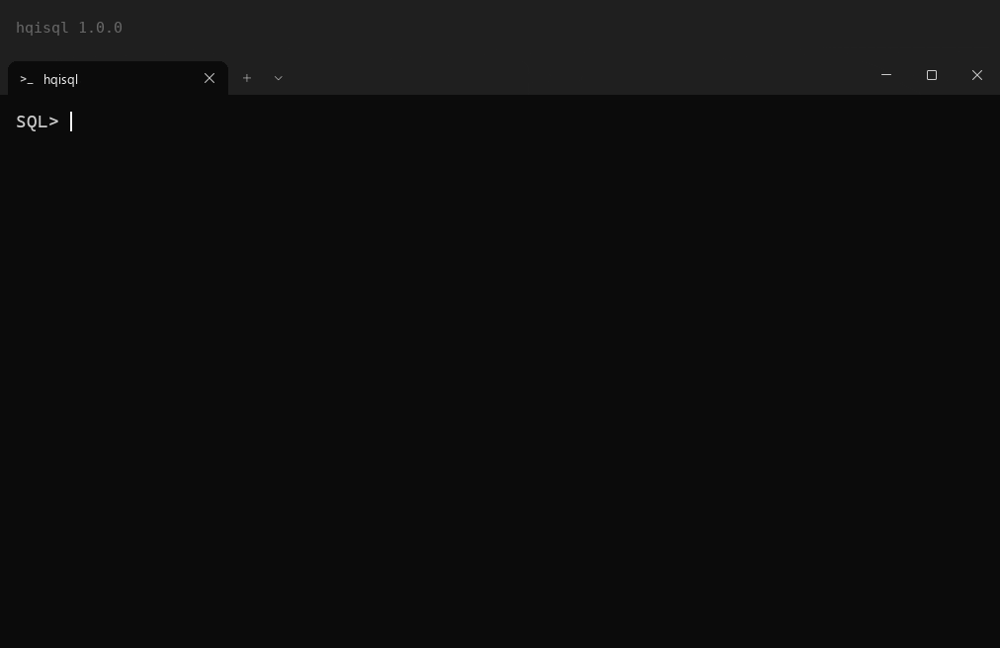

# hqisql

hqisql is an interactive console for Firebird. It is built from the same
source code as isql and accepts the same commands and command line options.
hqisql adds a line editor based on replxx, syntax highlighting, Tab
completion and new commands to load data from files. Scripts that do not use
the new commands give the same output as in isql.


More demos: [user guide](docs/hqisql.md). Portuguese captions: [guia](docs/pt-BR/hqisql.md).

## Features

- Multi-line line editor with statement history.
- Syntax highlighting of SQL and isql commands, with color schemes.
- Tab completion of keywords and of database object names.
- `PREPARE`, `EXEC SQL` and `DEALLOCATE`: run one statement with different
  values.
- `IMPORT INTO` and `EXEC SQL ... FROM`: load data from CSV, PostgreSQL
  `COPY` text, Apache Parquet and Avro files.
- `SET PAGELENGTH`: set the number of rows between column headers.
- `SET PREVIEW`: show the first rows of a result as a compact table.

## Supported Firebird versions

| | Versions | Tested in CI |
|---|---|---|
| Build | Firebird 5.0 source tree | `v5.0.4`, `v5.0-release` (Linux, Windows) |
| Client | fbclient of Firebird 5 | the same builds |
| Server | Firebird 3.0, 4.0, 5.0 | 5.0 embedded; 3.0.14 and 4.0.7 over TCP |

- There is no build for the Firebird 3 or 4 source tree. To work with a
  Firebird 3 or 4 server, run hqisql with the Firebird 5 client: it connects
  to these servers over TCP.
- Firebird 3 has no `IBatch`: `IMPORT INTO` and `EXEC SQL ... FROM` send one
  record at a time, so the load is slower. The result is the same.
- Firebird 2.5 is not supported.

CI runs the integration tests on the Docker images `firebirdsql/firebird:3`
and `firebirdsql/firebird:4`.

## Download

Ready-made builds for Linux x64 and Windows x64 are on the
[Releases](https://github.com/IBSurgeon/hqisql/releases) page. Check the
archive with `SHA256SUMS` from the same release.

- Linux (`hqisql-<version>-fb5-linux-x64.tar.gz`): copy `hqisql` to the
  `bin` directory of a Firebird 5 installation, for example
  `/opt/firebird/bin`. hqisql loads `libfbclient.so.2` and
  `libtomcrypt.so.1` from `../lib`. It is built in the Docker image of the
  official Firebird builds, so it runs on the same Linux versions.
- Windows (`hqisql-<version>-fb5-windows-x64.zip`): copy `hqisql.exe` and
  `libzstd.dll` to the directory of a Firebird 5 installation (with
  `fbclient.dll`).

<details><summary>hqisql on Windows</summary>



</details>

## Building

hqisql is installed into a Firebird 5.0 source tree and built with Firebird.
You need git (`install.sh` uses `git apply`).

Linux:

```
git clone -b v5.0.4 https://github.com/FirebirdSQL/firebird
git clone https://github.com/IBSurgeon/hqisql
hqisql/install.sh firebird && cd firebird && ./autogen.sh && make -j8 && make run_tests
```

The result is `gen/Release/firebird/bin/hqisql`.

Windows (needs Git for Windows and Visual Studio 2022; Visual Studio 2026
needs Firebird `v5.0-release`):

1. Run `hqisql\install.bat C:\src\firebird`.
2. In `C:\src\firebird\builds\win32`, run `make_icu.bat` and `make_boot.bat`.
3. Run `make_all.bat` (or `run_all.bat`).

`make_all.bat` builds hqisql, runs the unit tests and copies `hqisql.exe` to
`output_<platform>`.

See [Building](docs/hqisql.md#building) for the install options and the
runtime requirements.

## Documentation

- [User guide (English)](docs/hqisql.md)
- [Руководство (Russian)](docs/ru/hqisql.md)
- [Guia (Portuguese, Brazil)](docs/pt-BR/hqisql.md)
- [Handbuch (German)](docs/de/hqisql.md)
- [Color scheme sample](docs/hqisql-colors.txt)

## License

- hqisql code: Initial Developer's Public License (IDPL) 1.0. See
  [LICENSE](LICENSE).
- The patch to `isql.epp`: InterBase Public License (IPL), the same license
  as `isql.epp` itself.
- replxx: BSD license. See [NOTICE](NOTICE).

## Author

IBSurgeon
